<p align="center">
  
</p>

<h1 align="center">RapidQuant</h1>

<p align="center">
  <strong>Point-of-Care Bioanalytical AI Platform</strong><br>
  <em>100% Offline-First Lateral Flow Immunoassay (LFIA) Mobile & Web Quantification</em>
</p>

<p align="center">
  <a href="https://harishs-io.github.io/RapidQuant/"></a>
  <a href="https://raw.githubusercontent.com/harishs-io/RapidQuant/main/RapidQuant.apk"></a>
  <a href="https://harishs-io.github.io/RapidQuant/RapidQuant.ipa"></a>
  <a href="https://github.com/harishs-io/RapidQuant"></a>
  <a href="#license"></a>
</p>

---

## 📌 About RapidQuant

### 🧪 The Challenge: The Classical Laboratory Bottleneck
In traditional biomedical research and diagnostic assay development, conducting the laboratory validation of a Lateral Flow Immunoassay (LFIA) and determining its **Limit of Detection (LoD)** is a tedious, multi-hour manual ordeal:

1. **Manual Photography**: Capturing strip photos under inconsistent laboratory lighting.
2. **Manual Preprocessing**: Manually cropping nitrocellulose strip boundaries in image editing tools.
3. **ImageJ Densitometry**: Importing images into **ImageJ / Fiji**, hand-drawing bounding boxes over the Test (T) and Control (C) bands, and extracting raw 1D pixel intensity profile plots.
4. **Data Transcription**: Copying raw values into spreadsheets (Excel, Origin, or GraphPad Prism).
5. **Replicate Calculations**: Manually performing baseline background subtraction, numerical trapezoidal integration (Area Under the Curve — AUC), and computing replicate means, standard deviations, and coefficients of variation (%CV).
6. **Equation Solving & Statistics**: Manually fitting non-linear 4-Parameter Logistic (4PL) regression models and iteratively solving for the Limit of Blank ($\text{LoB}$) and Limit of Detection ($\text{LoD}$).

This classical routine requires hours to days per calibration series, introduces severe human subjectivity (differing crop margins, variable ImageJ box placements), and slows down critical diagnostic assay iterations.

---

### ⚡ The Solution: End-to-End One-Click Automation
**RapidQuant** completely automates this entire scientific validation pipeline into a single, seamless workflow:

> **Simply snap a photo or upload strip images — RapidQuant handles the entire computer vision, optical physics, 4PL regression, and replicate statistics in seconds, instantly outputting publication-ready figures.**

#### What RapidQuant Automates Instantly:
* 🤖 **Autonomous Strip Detection & Rectification**: Cascaded YOLOv8 AI isolates the reactive nitrocellulose membrane from any smartphone angle or ambient lighting, completely replacing manual image cropping ($99.5\%\text{ mAP@50}$).
* 📍 **Sub-Pixel Band Localization**: Pinpoints Control and Test bands with $\le 0.1\text{ px}$ spatial centroid precision, eliminating subjective hand-drawn ImageJ bounding boxes.
* 🌈 **LSPR Differential Optical Physics**: Extracts colloidal gold Localized Surface Plasmon Resonance absorption ($\lambda \approx 530\text{ nm}$) via differential densitometry ($\Delta A = A_{\text{Green}} - A_{\text{Red}} = I_{\text{Red}} - I_{\text{Green}}$) and removes membrane background gradients via 1D morphological grey opening (`grey_opening`, $R = 35\text{ px}$).
* 📊 **Automated Replicate Statistics**: Automatically groups experimental replicates across concentration series, computing mean analytical ratios, standard deviations, and %CV with zero spreadsheet transcription.
* 📈 **4PL Calibration & CLSI EP17-A2 LoD**: Automatically fits the non-linear 4-Parameter Logistic standard curve ($R^2 \ge 0.99$) and rigorously computes the Limit of Blank ($\text{LoB}$) and clinical Limit of Detection ($\text{LoD} = 0.0297\text{ ng/mL}$) with $95\%$ statistical certainty.
* 🎨 **Publication-Ready Figures & Reports**: Instantly generates high-resolution publication-quality vector plots (optical chromatograms with baseline continuum, 4PL calibration curves with replicate error bars, and analytical audit tables) ready for journal submissions, regulatory filings, or clinical point-of-care decisions.
* 🔒 **100% Offline & Private**: Runs entirely in the browser and native mobile apps without cloud servers or data transmission.

---

## 🚀 Download & Installation

### 🤖 1. Android Installation (Direct APK)
For any Android smartphone, tablet, or clinical field device (Samsung, Google Pixel, OnePlus, Xiaomi, etc.):

- **Direct Download**: [**`RapidQuant.apk` (v2.1.4)**](https://raw.githubusercontent.com/harishs-io/RapidQuant/main/RapidQuant.apk) *(43 MB, Build 6, Android 7.0 to 15+)*
- **What's New in v2.1.4**:
  * 📸 **Direct Samsung & Device Camera Launch**: Native `FileProvider` and `MediaStore.ACTION_IMAGE_CAPTURE` intent directly launches your phone's native camera hardware with tap-to-focus and macro mode.
  * 🔄 **Dual-Track Update System**: In-app OTA progress bar (0% ➔ 100%) for analytical models, plus automated system prompts when a native APK upgrade is available.
  * 🛡️ **Zero Data Loss Upgrades**: Installing `RapidQuant.apk` safely overwrites earlier builds in-place while keeping 100% of your saved strip records and calibration history intact.
- **Installation Steps**:
  1. Download `RapidQuant.apk` directly on your Android phone.
  2. Tap the downloaded file in your browser downloads or file notification.
  3. If prompted, allow *"Install unknown apps"* for your browser.
  4. Tap **Install** (or **Update**) ➔ Open **RapidQuant**!
  - Fully offline point-of-care bioanalytical platform with live camera alignment and hardware-accelerated local inference.

---

### 🍎 2. iOS Installation (iPhone & iPad — 2 Free Options)

#### Option A: Instant Web App / PWA (Recommended — 5 Seconds, No PC / No Cables)
Apple allows any iPhone user to install RapidQuant directly from Safari as a standalone offline app without needing an App Store account or TestFlight:

1. On your iPhone or iPad, open Safari and go to:  
   👉 **[https://harishs-io.github.io/RapidQuant/](https://harishs-io.github.io/RapidQuant/)**
2. Tap the **Share button** at the bottom (the square with an arrow pointing up: <kbd>⎋</kbd>).
3. Scroll down and tap **"Add to Home Screen"** (<kbd>➕</kbd>), then tap **Add**.
4. **RapidQuant** will appear on your iPhone home screen with the official icon.
5. Tap it to launch:
   - Launches in **full-screen standalone mode** (no Safari URL bars or browser controls).
   - Prompts for iPhone **Camera** permission for live cassette alignment.
   - Runs YOLOv8 AI models locally on your iPhone's Neural Engine / WebAssembly.
   - Works **100% offline in airplane mode**.

#### Option B: Direct Native IPA Installation via Sideloadly (Free for PC / Mac)
If you prefer installing the native iOS binary package onto your iPhone:

- **Package Download**: [**`RapidQuant.ipa`**](RapidQuant.ipa) *(42 MB, iOS 16.0+)*
- **Step-by-Step Installation**:
  1. Download and install **[Sideloadly](https://sideloadly.io/)** (Free for Windows & macOS).
  2. Connect your iPhone to your computer via USB cable.
  3. Open Sideloadly and drag & drop **`RapidQuant.ipa`** into the window.
  4. Enter your standard Apple ID (used solely to generate a free personal signing certificate).
  5. Click **Start** — Sideloadly will sign and install RapidQuant directly onto your iPhone.
  6. On your iPhone: Go to **Settings** ➔ **General** ➔ **VPN & Device Management**, tap your Apple ID, and tap **"Trust"**.
  7. Open **RapidQuant** on your iPhone!

---

## 🔬 Scientific & Algorithmic Pipeline

```mermaid
flowchart LR
    A["Raw Camera Frame<br/>/ Uploaded Image"] --> B["Stage 1: YOLOv8<br/>Strip Detector (WASM)"]
    B --> C["Nitrocellulose Bounding<br/>& Rectification"]
    C --> D["Stage 2: YOLOv8<br/>Band Classifier (WASM)"]
    D --> E["C-Band & T-Band<br/>Spatial Localization"]
    E --> F["LSPR Differential<br/>(G - R) Densitometry"]
    F --> G["1D Morphological<br/>Baseline (R = 35 px)"]
    G --> H["Noise-Gated 5% Apex<br/>AUC Integration"]
    H --> I["Analytical Optical Ratio<br/>y = AUC_T / AUC_C"]
    I --> J["4-Parameter Logistic (4PL)<br/>Inverse Calibration"]
    J --> K["Quantitative Concs +<br/>CLSI EP17-A2 LoD"]
    K --> L["Interactive Chromatogram<br/>& Audit Report"]
```



---

## 📐 Bioanalytical Optical Physics

### 1. LSPR Differential Densitometry ($A_{\text{Green}} - A_{\text{Red}}$)
Colloidal gold nanoparticles demonstrate localized surface plasmon resonance (LSPR) resulting in strong optical absorbance in the green spectrum ($\approx 530\text{ nm}$) while transmitting/scattering red light ($\approx 650\text{ nm}$). 

In optical densitometry, raw pixel intensity $I$ measures transmittance, so optical absorbance is defined as $A = 255 - I$. RapidQuant measures the differential absorbance ($A_{\text{Green}} - A_{\text{Red}}$):

$$\Delta A(y) = \max(0, A_{\text{Green}}(y) - A_{\text{Red}}(y)) = \max(0, I_{\text{Red}}(y) - I_{\text{Green}}(y))$$

* **Green Absorbance**: $A_{\text{Green}}(y) = 255 - I_{\text{Green}}(y)$ *(High on ruby-red gold bands)*
* **Red Absorbance**: $A_{\text{Red}}(y) = 255 - I_{\text{Red}}(y)$ *(Low on ruby-red gold bands)*
* **Algebraic Identity**: Subtracting red absorbance from green absorbance algebraically simplifies to raw **Red − Green**:
  $$\Delta A(y) = (255 - I_{\text{Green}}(y)) - (255 - I_{\text{Red}}(y)) = I_{\text{Red}}(y) - I_{\text{Green}}(y)$$
  This produces a clean, positive analytical peak directly over the reaction band.

### 2. Adaptive Morphological Baseline
To remove nitrocellulose membrane background gradients, non-specific binding stains, and ambient vignetting without flattening high-frequency reaction bands, RapidQuant implements a 1D morphological grey opening (`scipy.ndimage.grey_opening`) with sliding structuring radius $R = 35\text{ px}$ on the raw optical signal $S$:

1. **Erosion** *(scans local minimum within radius $R$)*:
   $$E(i) = \min_{|k| \le R} S[i + k]$$

2. **Dilation** *(creates lower morphological envelope connecting baseline valleys)*:
   $$D(i) = \max_{|k| \le R} E[i + k]$$

3. **Continuum Envelope** *(ensures baseline never exceeds raw optical signal)*:
   $$B(i) = \min(D(i), S[i])$$

4. **Net Signal Extraction** *(yields baseline-subtracted optical chromatogram)*:
   $$S_{\text{net}}(i) = \max(0, S[i] - B(i))$$

### 3. Noise Gating & 5% Apex Integration
* **Noise Rejection**: Requires peak apex height $\ge 5.0\text{ a.u.}$ and saddle delta $\ge 2.5\text{ a.u.}$, otherwise strictly forcing $T = 0.0000$ (True blank confirmed).
* **Boundary Scanning**: Scans laterally until the optical peak falls below 5% of the apex height.
* **Trapezoidal Integration**:
  $$\text{AUC} = \sum_{i} \frac{y_i + y_{i+1}}{2} \cdot dx, \quad \text{where } dx = \frac{1000}{H_{\text{membrane}}}$$

### 4. 4-Parameter Logistic (4PL) Calibration & LoD

RapidQuant converts the analytical optical ratio $y = \text{AUC}_T / \text{AUC}_C$ into an absolute analyte concentration ($x$) using a non-linear 4-Parameter Logistic (4PL) regression curve:

#### Mathematical Models

* **Forward Curve (Dose-Response)**:

$$
y = d + \frac{a - d}{1 + \left(\frac{x}{c}\right)^b}
$$

* **Inverse Calibration (Sample Quantification)**:

$$
x = c \cdot \left(\frac{a - d}{y - d} - 1\right)^{1/b}
$$

#### Parameters Overview

| Parameter | Calibrated Value | Bioanalytical Description |
| :--- | :--- | :--- |
| **$y$** | Analytical Signal | Optical response ratio: $y = \text{AUC}_T / \text{AUC}_C$ (Test line area normalized by Control line area). |
| **$x$** | Target Output | Unknown analyte concentration in sample ($\text{ng/mL}$). |
| **$a$** | `0.0000` | **Zero-Dose Baseline Floor**: Expected optical signal when no analyte is present ($x = 0$). |
| **$b$** | `5.0000` | **Hill Slope (Sensitivity)**: Steepness of the response curve; defines transition rate from blank to saturation. |
| **$c$** | `0.0581 ng/mL` | **Inflection Point ($\text{EC}_{50}$)**: Analyte concentration producing 50% maximal optical response ($\frac{a + d}{2}$). |
| **$d$** | `0.9722` | **Saturation Asymptote**: Upper plateau signal when all nanoparticle conjugate sites are saturated ($x \to \infty$). |

---

#### Limit of Detection (LoD) Determination (CLSI EP17-A2 Standard)

RapidQuant determines the clinical Limit of Detection (LoD) in strict accordance with the **CLSI EP17-A2** bioanalytical guidelines:

**Step 1: Limit of Blank (LoB)**  
Highest optical signal expected from a blank sample with 95% confidence ($\alpha = 0.05$):

$$
\text{LoB} = \mu_{\text{blank}} + 1.645 \cdot \sigma_{\text{blank}} = 0.0000
$$

**Step 2: Optical Detection Threshold (LoD Signal)**  
Lowest detectable optical ratio distinguishable from blank at a 95% detection rate ($\beta = 0.05$), with low-concentration repeatability standard deviation $\sigma = 0.020$:

$$
\text{LoD}_{\text{signal}} = \text{LoB} + 1.645 \cdot \sigma = 0 + (1.645 \cdot 0.020) = 0.0329
$$

**Step 3: Quantitative Limit of Detection Concentration (LoD Concentration)**  
Converted back into physical concentration ($\text{ng/mL}$) via the inverse 4PL equation:

$$
\text{LoD}_{\text{conc}} = c \cdot \left(\frac{a - d}{\text{LoD}_{\text{signal}} - d} - 1\right)^{1/b} = 0.0581 \cdot \left(\frac{0 - 0.9722}{0.0329 - 0.9722} - 1\right)^{1/5} = 0.0297\text{ ng/mL}
$$

#### Clinical Interpretation Rule
* **$y < 0.0329$** ($x < 0.0297\text{ ng/mL}$): **Negative / Below LoD** — Sample has no detectable analyte or falls below the reliable quantification threshold.
* **$y \ge 0.0329$** ($x \ge 0.0297\text{ ng/mL}$): **Positive & Quantified** — Analyte confirmed and quantified with $\ge 95\%$ analytical confidence.

---

## 🔄 Dual-Track Update System

RapidQuant utilizes an intelligent dual-track distribution and update architecture:

```
[Developer pushes git commit] 
             │
             ├──► Analytical / Math / UI update ────► Track 1: OTA Web Update (0% -> 100% Progress Bar)
             │                                         (Silent background download, auto-restart, no APK needed)
             │
             └──► Native Hardware / Camera change ──► Track 2: Native APK Update Dialog
                                                       (In-app popup prompt, 1-tap download, overwrites safely)
```

### Track 1: Over-the-Air (OTA) Instant Updates (Progress Bar & Auto-Restart)
For analytical pipeline adjustments, AI model parameters, densitometry filters, and UI features:
* **Silent Background Detection**: Queries `version.json` non-intrusively upon app launch.
* **Live Installation Progress Bar**: Shows interactive percentage progress (0% ➔ 100%) and stage descriptions (`Connecting...` ➔ `Querying manifest...` ➔ `Writing local storage...` ➔ `Restarting app...`).
* **Instant Auto-Restart**: Immediately hot-reloads the local app instance with cache busting.
* **Zero Network Penalty**: Operates 100% offline once downloaded.

### Track 2: Native Android System Upgrades (In-App Direct Downloader)
When core operating system features change (such as Android 14+ `MediaStore` hardware camera intents or native `FileProvider` configurations):
* **Automatic Compatibility Detection**: RapidQuant inspects the compiled binary version (`minApkVersion` in `version.json`).
* **Direct Upgrade Modal**: Displays a clean update dialog explaining the new hardware features with a 1-tap download link for `RapidQuant.apk`.
* **Guaranteed Data Preservation**: Android automatically installs the new package over the old one without removing user files, calibrated standards, or saved historical assays.

---

## 📂 Repository Structure

```text
RapidQuant/
├── assets/
│   ├── logo.png                   # Official Colloidal Gold LFIA icon mark
│   ├── banner_bg.jpg              # Microfluidic 3D strip background
│   ├── icon-192.png               # PWA launcher icon (192x192)
│   └── icon-512.png               # PWA splash icon (512x512)
├── index.html                     # Full standalone WebAssembly bioanalytical application
├── version.json                   # Cloud OTA update manifest
├── manifest.json                  # PWA configuration manifest
├── sw.js                          # Service Worker for offline asset caching
├── best_strip_detector.onnx       # Stage 1 YOLOv8 nitrocellulose detector (FP16)
├── best_band_detector.onnx        # Stage 2 YOLOv8 band classifier (FP16)
├── ort.all.min.js                 # Microsoft ONNX Runtime WebAssembly loader
├── ort-wasm.wasm                  # Hardware-accelerated WASM inference engine
├── ort-wasm-simd.wasm             # SIMD vector-accelerated WASM engine
├── ort-wasm-threaded.wasm         # Multi-threaded background WASM worker
└── README.md                      # Comprehensive project documentation
```

---

## 🛠 Local Development & Testing

### Running Locally
To test the web application locally with camera and WebAssembly capabilities enabled:

```bash
# Clone the repository
git clone https://github.com/harishs-io/RapidQuant.git
cd RapidQuant

# Start a local HTTPS/HTTP server
python3 -m http.server 8080
```
Open `http://localhost:8080/` in your browser.

---

## 🔒 Privacy & Offline Security

- **Zero Cloud Data Transmission**: Sample images and patient diagnostic metrics never leave the user's physical device.
- **Airplane-Mode Operable**: Once loaded or installed, the application functions identically with all network radios disabled.
- **Sandboxed Execution**: Runs within isolated WebAssembly and native Android sandboxes with no external third-party tracking scripts.

---

## 📄 License

This project is licensed under the **MIT License** — see the [LICENSE](LICENSE) file for details.

---

<p align="center">
  Developed with ❤️ for Global Point-of-Care Diagnostic Accessibility.<br>
  <strong>RapidQuant Platform — Precise, Fast, and Completely Offline.</strong>
</p>

