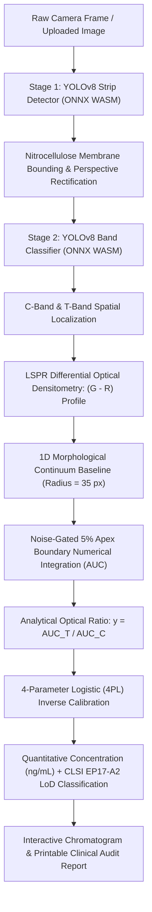

<p align="center">
  
</p>

<h1 align="center">RapidQuant</h1>

<p align="center">
  <strong>Point-of-Care Bioanalytical AI Platform</strong><br>
  <em>100% Offline-First Lateral Flow Immunoassay (LFIA) Mobile & Web Quantification</em>
</p>

<p align="center">
  <a href="https://harishs-io.github.io/RapidQuant/"></a>
  <a href="https://harishs-io.github.io/RapidQuant/RapidQuant.apk"></a>
  <a href="https://harishs-io.github.io/RapidQuant/RapidQuant.ipa"></a>
  <a href="https://github.com/harishs-io/RapidQuant"></a>
  <a href="#license"></a>
</p>

---

## 📌 Overview

**RapidQuant** is an enterprise-grade, medical-oriented point-of-care bioanalytical platform designed for high-precision quantification of colloidal gold (AuNP) Lateral Flow Immunoassays (LFIA). 

RapidQuant replaces subjective, qualitative visual reading with objective, laboratory-grade optical densitometry and machine-learning-driven quantification directly on mobile phones and edge web browsers.

### 🌟 Key Highlights

- ⚡ **100% Offline-First**: Performs dual-stage neural network inference, mathematical morphology, and numerical integration fully on-device. Zero cloud server dependency, zero internet latency, and zero telemetry (HIPAA/GDPR compliant by design).
- 🔬 **Cascaded Dual-Stage YOLOv8**: Dedicated edge-optimized ONNX models running via WebAssembly (WASM):
  - **Stage 1 (Cassette/Strip Detector)**: Detects and crops the nitrocellulose membrane area regardless of ambient illumination or perspective tilt.
  - **Stage 2 (Band Classifier)**: Identifies, bounds, and classifies the **Control (C)** and **Test (T)** reaction lines with sub-pixel centroid accuracy.
- 🌈 **LSPR Differential Optical Densitometry ($A_{\text{Green}} - A_{\text{Red}}$)**: Targets the Localized Surface Plasmon Resonance absorbance peak of colloidal gold nanoparticles ($\lambda \approx 530\text{ nm}$).
- 📈 **1D Morphological Continuum Baseline**: Transpiled from mathematical morphology (`scipy.ndimage.grey_opening`, $R = 35\text{ px}$) to dynamically eliminate nitrocellulose background gradients, sample matrix meniscus, and illumination shadowing.
- 🎯 **5% Apex Integration & Noise Gating**: Eliminates false positives on blank specimens ($T = 0.0000$), measuring true Area Under the Curve (AUC) in normalized migration distance ($R_f$) units.
- 📐 **4-Parameter Logistic (4PL) Calibration**: Inverts optical density ratios ($T/C$) into true analyte concentrations (e.g., ng/mL) with clinical Limit of Detection (LoD) calculations conforming to **CLSI EP17-A2**.
- 🔄 **Over-the-Air (OTA) Instant Web Updates**: Automatic background updates delivered via GitHub Pages without requiring users to reinstall an APK.

---

## 🚀 Download & Installation

### 🤖 1. Android Installation (Direct APK)
For any Android smartphone, tablet, or clinical field device (Samsung, Google Pixel, OnePlus, Xiaomi, etc.):

- **Direct Download**: [**`RapidQuant.apk`**](RapidQuant.apk) *(43 MB, API level 24 to 35)*
- **Installation Steps**:
  1. Download `RapidQuant.apk` directly on your Android phone.
  2. Tap the downloaded file in your browser downloads or file manager.
  3. If prompted, allow *"Install unknown apps"* for your browser.
  4. Tap **Install** ➔ Open **RapidQuant**!
  - Fully offline point-of-care bioanalytical platform with live camera alignment and hardware-accelerated local inference.

---

### 🍎 2. iOS Installation (iPhone & iPad — 2 Free Options)

#### Option A: Instant Web App / PWA (Recommended — 5 Seconds, No PC / No Cables)
Apple allows any iPhone user to install RapidQuant directly from Safari as a standalone offline app without needing an App Store account or TestFlight:

1. On your iPhone or iPad, open Safari and go to:  
   👉 **[https://harishs-io.github.io/RapidQuant/](https://harishs-io.github.io/RapidQuant/)**
2. Tap the **Share button** at the bottom (the square with an arrow pointing up: <kbd>⎋</kbd>).
3. Scroll down and tap **"Add to Home Screen"** (<kbd>➕</kbd>), then tap **Add**.
4. **RapidQuant** will appear on your iPhone home screen with the official icon.
5. Tap it to launch:
   - Launches in **full-screen standalone mode** (no Safari URL bars or browser controls).
   - Prompts for iPhone **Camera** permission for live cassette alignment.
   - Runs YOLOv8 AI models locally on your iPhone's Neural Engine / WebAssembly.
   - Works **100% offline in airplane mode**.

#### Option B: Direct Native IPA Installation via Sideloadly (Free for PC / Mac)
If you prefer installing the native iOS binary package onto your iPhone:

- **Package Download**: [**`RapidQuant.ipa`**](RapidQuant.ipa) *(42 MB, iOS 16.0+)*
- **Step-by-Step Installation**:
  1. Download and install **[Sideloadly](https://sideloadly.io/)** (Free for Windows & macOS).
  2. Connect your iPhone to your computer via USB cable.
  3. Open Sideloadly and drag & drop **`RapidQuant.ipa`** into the window.
  4. Enter your standard Apple ID (used solely to generate a free personal signing certificate).
  5. Click **Start** — Sideloadly will sign and install RapidQuant directly onto your iPhone.
  6. On your iPhone: Go to **Settings** ➔ **General** ➔ **VPN & Device Management**, tap your Apple ID, and tap **"Trust"**.
  7. Open **RapidQuant** on your iPhone!

---

## 🔬 Scientific & Algorithmic Pipeline



---

## 📐 Bioanalytical Optical Physics

### 1. LSPR Differential Densitometry ($A_{\text{Green}} - A_{\text{Red}}$)
Colloidal gold nanoparticles demonstrate localized surface plasmon resonance (LSPR) resulting in strong optical absorbance in the green spectrum ($\approx 530\text{ nm}$) while transmitting/scattering red light ($\approx 650\text{ nm}$). 

In optical densitometry, raw pixel intensity $\bar{I}$ measures transmittance, so optical absorbance is defined as $A = 255 - \bar{I}$. RapidQuant measures the differential absorbance ($A_{\text{Green}} - A_{\text{Red}}$):

$$\Delta A(y) = \max\Big(0,\, A_{\text{Green}}(y) - A_{\text{Red}}(y)\Big) = \max\Big(0,\, \bar{I}_{\text{Red}}(y) - \bar{I}_{\text{Green}}(y)\Big)$$

* **Green Absorbance**: $A_{\text{Green}}(y) = 255 - \bar{I}_{\text{Green}}(y)$ *(High on ruby-red gold bands)*
* **Red Absorbance**: $A_{\text{Red}}(y) = 255 - \bar{I}_{\text{Red}}(y)$ *(Low on ruby-red gold bands)*
* **Algebraic Identity**: Subtracting red absorbance from green absorbance algebraically simplifies to raw $(\bar{I}_{\text{Red}} - \bar{I}_{\text{Green}})$, yielding a clean positive analytical peak.

### 2. Adaptive Morphological Baseline
To remove membrane wetting gradients, non-specific binding stains, and ambient vignetting without flattening high-frequency reaction bands, RapidQuant implements a 1D morphological grey opening with structuring element radius $R = 35\text{ px}$:

1. **Erosion**: $E(i) = \min_{j \in [i-R, i+R]} \text{Signal}[j]$
2. **Dilation**: $D(i) = \max_{j \in [i-R, i+R]} E[j]$
3. **Continuum Envelope**: $\text{Baseline}[i] = \min(D(i),\, \text{Signal}[i])$
4. **Net Signal**: $\text{NetSignal}[i] = \max(0,\, \text{Signal}[i] - \text{Baseline}[i])$

### 3. Noise Gating & 5% Apex Integration
* **Noise Rejection**: Requires peak apex height $\ge 5.0\text{ a.u.}$ and saddle delta $\ge 2.5\text{ a.u.}$, otherwise strictly forcing $T = 0.0000$ (True blank confirmed).
* **Boundary Scanning**: Scans laterally until the optical peak falls below 5% of the apex height.
* **Trapezoidal Integration**:
  $$\text{AUC} = \sum_{i} \frac{y_i + y_{i+1}}{2} \cdot dx, \quad \text{where } dx = \frac{1000}{H_{\text{membrane}}}$$

### 4. 4-Parameter Logistic (4PL) Inverse Calibration
Solves the dynamic concentration $x$ from the analytical ratio $y = \text{AUC}_T / \text{AUC}_C$:

$$x = c \cdot \left(\frac{a - d}{y - d} - 1\right)^{1/b}$$

* $a = 0.0000$ (Blank baseline floor)
* $b = 5.0000$ (Hill slope coefficient)
* $c = 0.0581\text{ ng/mL}$ (Inflection point / $\text{EC}_{50}$)
* $d = 0.9722$ (Saturation asymptote)
* $\text{LoD} = 0.0297\text{ ng/mL}$ (Limit of Detection conforming to CLSI EP17-A2)

---

## 🔄 Over-the-Air (OTA) Instant Updates

RapidQuant features a hybrid OTA deployment architecture powered by GitHub Pages:

```
[Developer updates code] 
         │
         ▼
[git push origin main] ──► [GitHub Pages CDN]
                                  │
                                  ▼
           ┌──────────────────────────────────────────────┐
           │        User Device (Android / iOS / Web)     │
           │                                              │
           │ 1. Non-blocking silent version check         │
           │ 2. Background download of updated index.html │
           │ 3. Persistent cache in app storage (ota_web) │
           │ 4. Instant one-click update banner           │
           │ 5. 100% offline functionality preserved!     │
           └──────────────────────────────────────────────┘
```

---

## 📂 Repository Structure

```text
RapidQuant/
├── assets/
│   ├── logo.png                   # Official Colloidal Gold LFIA icon mark
│   ├── banner_bg.jpg              # Microfluidic 3D strip background
│   ├── icon-192.png               # PWA launcher icon (192x192)
│   └── icon-512.png               # PWA splash icon (512x512)
├── index.html                     # Full standalone WebAssembly bioanalytical application
├── version.json                   # Cloud OTA update manifest
├── manifest.json                  # PWA configuration manifest
├── sw.js                          # Service Worker for offline asset caching
├── best_strip_detector.onnx       # Stage 1 YOLOv8 nitrocellulose detector (FP16)
├── best_band_detector.onnx        # Stage 2 YOLOv8 band classifier (FP16)
├── ort.all.min.js                 # Microsoft ONNX Runtime WebAssembly loader
├── ort-wasm.wasm                  # Hardware-accelerated WASM inference engine
├── ort-wasm-simd.wasm             # SIMD vector-accelerated WASM engine
├── ort-wasm-threaded.wasm         # Multi-threaded background WASM worker
└── README.md                      # Comprehensive project documentation
```

---

## 🛠 Local Development & Testing

### Running Locally
To test the web application locally with camera and WebAssembly capabilities enabled:

```bash
# Clone the repository
git clone https://github.com/harishs-io/RapidQuant.git
cd RapidQuant

# Start a local HTTPS/HTTP server
python3 -m http.server 8080
```
Open `http://localhost:8080/` in your browser.

---

## 🔒 Privacy & Offline Security

- **Zero Cloud Data Transmission**: Sample images and patient diagnostic metrics never leave the user's physical device.
- **Airplane-Mode Operable**: Once loaded or installed, the application functions identically with all network radios disabled.
- **Sandboxed Execution**: Runs within isolated WebAssembly and native Android sandboxes with no external third-party tracking scripts.

---

## 📄 License

This project is licensed under the **MIT License** — see the [LICENSE](LICENSE) file for details.

---

<p align="center">
  Developed with ❤️ for Global Point-of-Care Diagnostic Accessibility.<br>
  <strong>RapidQuant Platform — Precise, Fast, and Completely Offline.</strong>
</p>

