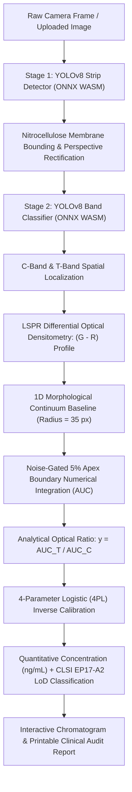

<p align="center">
  
</p>

<h1 align="center">RapidQuant</h1>

<p align="center">
  <strong>Point-of-Care Bioanalytical AI Platform</strong><br>
  <em>100% Offline-First Lateral Flow Immunoassay (LFIA) Mobile & Web Quantification</em>
</p>

<p align="center">
  <a href="https://harishs-io.github.io/RapidQuant/"></a>
  <a href="https://github.com/harishs-io/RapidQuant"></a>
  <a href="#offline-first-privacy-by-design"></a>
  <a href="#over-the-air-ota-instant-updates"></a>
  <a href="#license"></a>
</p>

---

## 📌 Overview

**RapidQuant** is an enterprise-grade, medical-oriented point-of-care bioanalytical platform designed for high-precision quantification of colloidal gold (AuNP) Lateral Flow Immunoassays (LFIA). 

RapidQuant replaces subjective, qualitative visual reading with objective, laboratory-grade optical densitometry and machine-learning-driven quantification directly on mobile phones and edge web browsers.

### 🌟 Key Highlights

- ⚡ **100% Offline-First**: Performs dual-stage neural network inference, mathematical morphology, and numerical integration fully on-device. Zero cloud server dependency, zero internet latency, and zero telemetry (HIPAA/GDPR compliant by design).
- 🔬 **Cascaded Dual-Stage YOLOv8**: Dedicated edge-optimized ONNX models running via WebAssembly (WASM):
  - **Stage 1 (Cassette/Strip Detector)**: Detects and crops the nitrocellulose membrane area regardless of ambient illumination or perspective tilt.
  - **Stage 2 (Band Classifier)**: Identifies, bounds, and classifies the **Control (C)** and **Test (T)** reaction lines with sub-pixel centroid accuracy.
- 🌈 **LSPR Differential Optical Densitometry ($G - R$)**: Targets the Localized Surface Plasmon Resonance absorbance peak of colloidal gold nanoparticles ($\lambda \approx 530\text{ nm}$).
- 📈 **1D Morphological Continuum Baseline**: Transpiled from mathematical morphology (`scipy.ndimage.grey_opening`, $R = 35\text{ px}$) to dynamically eliminate nitrocellulose background gradients, sample matrix meniscus, and illumination shadowing.
- 🎯 **5% Apex Integration & Noise Gating**: Eliminates false positives on blank specimens ($T = 0.0000$), measuring true Area Under the Curve (AUC) in normalized migration distance ($R_f$) units.
- 📐 **4-Parameter Logistic (4PL) Calibration**: Inverts optical density ratios ($T/C$) into true analyte concentrations (e.g., ng/mL) with clinical Limit of Detection (LoD) calculations conforming to **CLSI EP17-A2**.
- 🔄 **Over-the-Air (OTA) Instant Web Updates**: Automatic background updates delivered via GitHub Pages without requiring users to reinstall an APK.

---

## 🚀 Live Access & Installation

### 1. Web App / Progressive Web App (PWA)
Launch instantly in any modern mobile or desktop browser (Chrome, Safari, Edge, Firefox):
👉 **[https://harishs-io.github.io/RapidQuant/](https://harishs-io.github.io/RapidQuant/)**

> **Install as PWA**: Open the link on your mobile device, tap the browser menu (or share icon on iOS), and select **"Add to Home Screen"**. The app installs as a native-like app that opens full-screen and works completely offline!

### 2. Standalone Android Release APK
For clinical field tablets and air-gapped Android devices, a production APK with native hardware camera integration and local storage persistence is available:
- **Download**: [`app-release.apk`](file:///Volumes/PERSONAL/EVL/LFIA/mobile_app/web_pwa/app-release.apk) (bundled in repository releases).
- **Target OS**: Android 7.0+ (API level 24 to 35).
- **Permissions**: Camera (for real-time strip scanning) and File Access (for saving audit reports).

---

## 🔬 Scientific & Algorithmic Pipeline



---

## 📐 Bioanalytical Optical Physics

### 1. LSPR Differential Densitometry ($G - R$)
Colloidal gold nanoparticles demonstrate localized surface plasmon resonance resulting in strong optical absorption in the blue-green spectrum ($\approx 530\text{ nm}$) while scattering or transmitting red wavelengths ($\approx 650\text{ nm}$). RapidQuant calculates row-averaged optical density as:

$$\text{Diff}(y) = \text{Clamp}\Big([255 - \bar{I}_{\text{Green}}(y)] - [255 - \bar{I}_{\text{Red}}(y)],\, 0,\, 255\Big) = \text{Clamp}\Big(\bar{I}_{\text{Red}}(y) - \bar{I}_{\text{Green}}(y),\, 0,\, 255\Big)$$

### 2. Adaptive Morphological Baseline
To remove membrane wetting gradients, non-specific binding stains, and ambient vignetting without flattening high-frequency reaction bands, RapidQuant implements a 1D morphological grey opening with structuring element radius $R = 35\text{ px}$:

1. **Erosion**: $E(i) = \min_{j \in [i-R, i+R]} \text{Signal}[j]$
2. **Dilation**: $D(i) = \max_{j \in [i-R, i+R]} E[j]$
3. **Continuum Envelope**: $\text{Baseline}[i] = \min(D(i),\, \text{Signal}[i])$
4. **Net Signal**: $\text{NetSignal}[i] = \max(0,\, \text{Signal}[i] - \text{Baseline}[i])$

### 3. Noise Gating & 5% Apex Integration
* **Noise Rejection**: Requires peak apex height $\ge 5.0\text{ a.u.}$ and saddle delta $\ge 2.5\text{ a.u.}$, otherwise strictly forcing $T = 0.0000$ (True blank confirmed).
* **Boundary Scanning**: Scans laterally until the optical peak falls below $5\%$ of the apex height.
* **Trapezoidal Integration**:
  $$\text{AUC} = \sum_{i} \frac{y_i + y_{i+1}}{2} \cdot dx, \quad \text{where } dx = \frac{1000}{\text{membrane\_height}}$$

### 4. 4-Parameter Logistic (4PL) Inverse Calibration
Solves the dynamic concentration $x$ from the analytical ratio $y = \text{AUC}_T / \text{AUC}_C$:

$$x = c \cdot \left(\frac{a - d}{y - d} - 1\right)^{1/b}$$

* $a = 0.0000$ (Blank baseline floor)
* $b = 5.0000$ (Hill slope coefficient)
* $c = 0.0581\text{ ng/mL}$ (Inflection point / $\text{EC}_{50}$)
* $d = 0.9722$ (Saturation asymptote)
* $\text{LoD} = 0.0297\text{ ng/mL}$ (Limit of Detection conforming to CLSI EP17-A2)

---

## 🔄 Over-the-Air (OTA) Instant Updates

RapidQuant features a hybrid OTA deployment architecture powered by GitHub Pages:

```
[Developer updates code] 
         │
         ▼
[git push origin main] ──► [GitHub Pages CDN]
                                  │
                                  ▼
           ┌──────────────────────────────────────────────┐
           │        User Device (Android / iOS / Web)     │
           │                                              │
           │ 1. Non-blocking silent version check         │
           │ 2. Background download of updated index.html │
           │ 3. Persistent cache in app storage (ota_web) │
           │ 4. Instant one-click update banner           │
           │ 5. 100% offline functionality preserved!     │
           └──────────────────────────────────────────────┘
```

### How to Release an App Update
When you introduce new calibration formulas, clinical assays, or UI enhancements:
1. Edit `index.html` with your updates.
2. Increment the version number in `version.json`:
   ```json
   {
     "appName": "RapidQuant",
     "version": "2.1.0",
     "build": 2,
     "releaseDate": "2026-11-01",
     "otaUrl": "https://harishs-io.github.io/RapidQuant/",
     "changelog": "Added multi-target multiplexed band calibration."
   }
   ```
3. Commit and push:
   ```bash
   git commit -am "feat: release v2.1.0"
   git push origin main
   ```
Every installed app will automatically detect and receive the update in the background when connected to the internet, without anyone having to reinstall an APK.

---

## 📂 Repository Structure

```text
RapidQuant/
├── assets/
│   ├── logo.png                   # Official Colloidal Gold LFIA icon mark
│   ├── banner_bg.jpg              # Microfluidic 3D strip background
│   ├── icon-192.png               # PWA launcher icon (192x192)
│   └── icon-512.png               # PWA splash icon (512x512)
├── index.html                     # Full standalone WebAssembly bioanalytical application
├── version.json                   # Cloud OTA update manifest
├── manifest.json                  # PWA configuration manifest
├── sw.js                          # Service Worker for offline asset caching
├── best_strip_detector.onnx       # Stage 1 YOLOv8 nitrocellulose detector (FP16)
├── best_band_detector.onnx        # Stage 2 YOLOv8 band classifier (FP16)
├── ort.all.min.js                 # Microsoft ONNX Runtime WebAssembly loader
├── ort-wasm.wasm                  # Hardware-accelerated WASM inference engine
├── ort-wasm-simd.wasm             # SIMD vector-accelerated WASM engine
├── ort-wasm-threaded.wasm         # Multi-threaded background WASM worker
└── README.md                      # Comprehensive project documentation
```

---

## 🛠 Local Development & Testing

### Running Locally
To test the web application locally with camera and WebAssembly capabilities enabled:

```bash
# Clone the repository
git clone https://github.com/harishs-io/RapidQuant.git
cd RapidQuant

# Start a local HTTPS/HTTP server
python3 -m http.server 8080
```
Open `http://localhost:8080/` in your browser.

---

## 🔒 Privacy & Offline Security

- **Zero Cloud Data Transmission**: Sample images and patient diagnostic metrics never leave the user's physical device.
- **Airplane-Mode Operable**: Once loaded or installed, the application functions identically with all network radios disabled.
- **Sandboxed Execution**: Runs within isolated WebAssembly and native Android sandboxes with no external third-party tracking scripts.

---

## 📄 License

This project is licensed under the **MIT License** — see the [LICENSE](LICENSE) file for details.

---

<p align="center">
  Developed with ❤️ for Global Point-of-Care Diagnostic Accessibility.<br>
  <strong>RapidQuant Platform — Precise, Fast, and Completely Offline.</strong>
</p>
